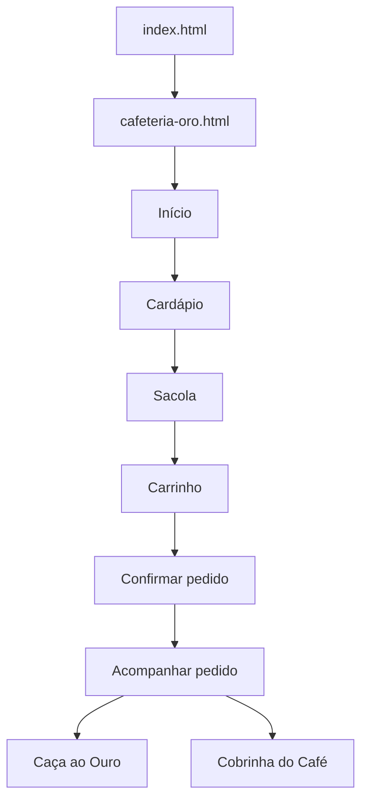

# ☕ Oro Café

> O valor dos pequenos momentos.

Projeto acadêmico de JavaScript que simula a experiência digital de uma cafeteria fictícia, reunindo cardápio interativo, carrinho de compras, acompanhamento de pedidos e jogos personalizados.

[**Acessar o site online**](https://hildebertosampaiojr-bot.github.io/Cafeteria---Trabalho-javascript/)

## 🎯 Objetivo

Aplicar conceitos de desenvolvimento web front-end e lógica de programação em uma aplicação interativa, responsiva e organizada, utilizando tecnologias nativas do navegador.

## 🛠️ Tecnologias utilizadas

| Tecnologia | Aplicação no projeto |
| --- | --- |
| HTML5 | Estrutura semântica, seções, formulários, diálogos, SVG e elemento Canvas. |
| CSS3 | Identidade visual, variáveis CSS, Grid, Flexbox, responsividade, transições e animações. |
| JavaScript (Vanilla JS) | Cardápio, filtros, carrinho, cálculos, navegação, pedidos e lógica dos jogos. |
| DOM API | Eventos, seleção e criação de elementos, atualização de conteúdo e atributos. |
| Canvas 2D API | Desenho do tabuleiro, cobrinha e grãos de café. |
| Web Animations API | Transição circular entre as telas com `Element.animate()`. |
| Web Storage API | Uso de `localStorage` para armazenar o recorde da cobrinha. |
| Git | Controle de versões do código-fonte. |
| GitHub | Hospedagem e gerenciamento do repositório. |
| GitHub Pages | Publicação estática do site. |
| WebP | Formato das imagens da marca e dos produtos, armazenadas na pasta `assets/`. |

Toda a aplicação funciona com HTML, CSS e JavaScript puro, sem frameworks, dependências externas ou etapa de compilação.

## ✨ Funcionalidades

### Cardápio digital

- Dez produtos com imagens, descrições e preços.
- Filtros por categoria: todos, bebidas e comidas.
- Cartões expansíveis por mouse, toque ou teclado.
- Confirmação temporária ao adicionar um produto à sacola.

### Sacola e carrinho

- Contador de itens atualizado automaticamente.
- Resumo dos produtos, quantidades e valores.
- Fechamento do resumo pelo botão X, Esc ou clique externo.
- Ajuste de quantidades, remoção de itens e cálculo do total em reais.
- Formulário com campo obrigatório de nome para retirada.

### Acompanhamento de pedidos

Ao confirmar, o sistema registra o pedido demonstrativo, esvazia o carrinho e redireciona para a tela de acompanhamento, com uma mensagem de confirmação.

| Etapa | Momento simulado |
| --- | --- |
| Pedido recebido | Imediatamente após a confirmação |
| Em preparo | Após 20 segundos |
| Pronto para retirada | Após 2 minutos |

### Oro Play

Enquanto aguarda, o cliente pode escolher um dos dois jogos:

| Jogo | Funcionamento |
| --- | --- |
| Caça ao Ouro | Jogo da memória com 16 cartas, oito pares de produtos, embaralhamento e contador de jogadas. |
| Cobrinha do Café | Coleta de grãos de café em um tabuleiro Canvas, com pontuação, recorde local, pausa e reinício. |

A cobrinha pode ser controlada pelas setas, pelas teclas WASD ou pelos botões direcionais na tela.

## 🎨 Identidade visual

A interface apresenta uma combinação de azul-marinho, dourado e tons claros, com uma proposta visual inspirada em cafeterias de cafés especiais e confeitaria artesanal.

| Cor | Hexadecimal | Aplicação |
| --- | --- | --- |
| Azul-marinho | `#061426` | Fundo principal e transição entre telas |
| Dourado | `#E7B96A` | Destaques, botões e detalhes |
| Creme | `#F8F1E4` | Textos e elementos claros |

O layout utiliza CSS Grid, Flexbox e media queries para adaptação a diferentes dimensões de tela. Também considera a preferência do navegador por movimento reduzido.

## 📁 Estrutura do projeto

```text
Cafeteria---Trabalho-javascript/
├── index.html          # Entrada e redirecionamento do site
├── cafeteria-oro.html  # Interface completa da cafeteria
├── estilo.css          # Estilos, componentes e responsividade
├── script.js           # Lógica da aplicação e dos jogos
├── assets/             # Logo e imagens WebP dos dez produtos
└── README.md           # Documentação
```

## 🧠 Conceitos de JavaScript aplicados

| Conceito | Exemplo no projeto |
| --- | --- |
| Variáveis, arrays e objetos | Produtos, quantidades, pedidos e estado dos jogos. |
| Condicionais e laços | Validação de ações, filtros, formação de pares e colisões. |
| Funções e eventos | Interações do cardápio, sacola e controles dos jogos. |
| Métodos de arrays | `map()`, `reduce()`, `forEach()`, `find()` e `some()`. |
| Manipulação do DOM | Renderização dinâmica do carrinho e das cartas. |
| Temporizadores | `setTimeout()` e `setInterval()` no feedback, nos pedidos e nos jogos. |
| Números e aleatoriedade | Cálculos, embaralhamento das cartas e posição dos grãos. |
| Navegação por hash | Alternância de seções com `location.hash` e `hashchange`. |
| Persistência local | Recorde da cobrinha com `localStorage`. |

## 🔄 Fluxo da aplicação



## 🚀 Como executar localmente

```bash
git clone https://github.com/hildebertosampaiojr-bot/Cafeteria---Trabalho-javascript.git
cd Cafeteria---Trabalho-javascript
```

Abra `index.html` em um navegador atualizado ou utilize a extensão Live Server no Visual Studio Code. O arquivo de entrada redireciona para `cafeteria-oro.html`, que também pode ser aberto diretamente.

## 🔧 Manutenção e evolução

- **Produtos:** edite os cartões do cardápio em `cafeteria-oro.html`, mantendo a categoria, descrição, imagem, preço exibido e atributo `data-price` consistentes. O JavaScript lê os dados desses cartões.
- **Visual:** ajuste a paleta, os componentes e os pontos de quebra em `estilo.css`.
- **Interações:** altere as funções correspondentes em `script.js`. Os principais botões usam atributos `data-action`.
- **Imagens:** utilize arquivos na pasta `assets/` e atualize os caminhos no HTML.

Possíveis melhorias futuras incluem integração com backend, catálogo dinâmico, persistência de pedidos e painel administrativo.

## ⚠️ Limitações

Esta é uma aplicação demonstrativa, sem backend, banco de dados, autenticação, pagamentos ou integração com uma cafeteria real. Os pedidos e o carrinho permanecem na memória da página; apenas o recorde da cobrinha é salvo localmente quando o navegador permite. Os estados do pedido são simulados por tempo.

## 🔗 Outro trabalho acadêmico

Conheça também **[Lâmpada Funcional](https://github.com/hildebertosampaiojr-bot/Lampada-Funcional)**, um simulador de interruptor que pratica condicionais, eventos e manipulação do DOM.

[Abrir Lâmpada Funcional](https://hildebertosampaiojr-bot.github.io/Lampada-Funcional/)

---

Projeto educacional de desenvolvimento web front-end.
